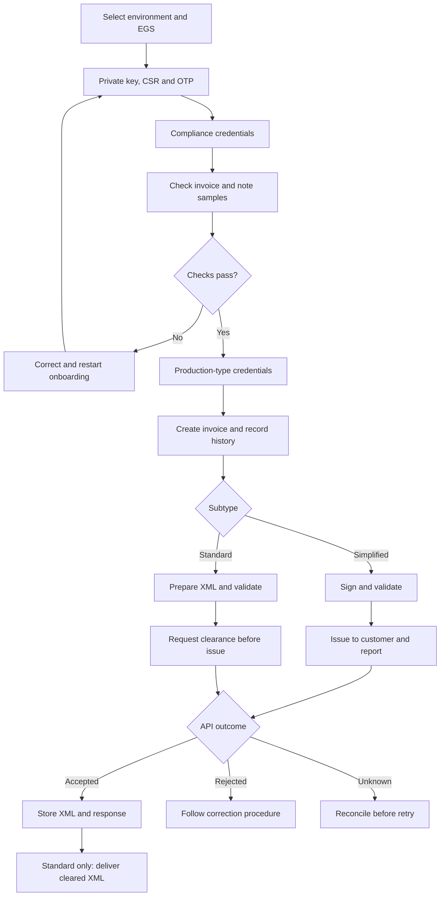

# Report your first sandbox invoice

Pick Python, C#, or TypeScript and run one program that creates a simplified
invoice for SAR 115, signs it, validates the signed XML, and reports it to ZATCA's
Integration Sandbox. It saves the response and checks whether reporting was
accepted. Each language follows the same steps and uses the same input file.

You need a sandbox certificate and its matching private key. Reporting also needs
the sandbox token and secret issued for that device. Without credentials, you can
run the local steps with the public test certificate below; that run sends nothing.

## Where this fits in the ZATCA journey

An EGS is your electronic invoice generation system. Onboarding identifies each
EGS unit and gives it credentials. Once onboarded, it can submit invoices and notes.



Keep credentials under lifecycle management too: renew them before expiry and
revoke them when the EGS unit is retired or its credentials must be withdrawn.
A connection failure can leave the API outcome unknown.


The runnable examples cover the simplified branch: creation through reporting.
In live operation, simplified documents are reported within 24 hours. Standard
documents follow clearance before customer delivery; retain the returned cleared
XML. These are separate submission paths. ZATCA describes both in sections 4.3.1
and 4.3.2 of its [Detailed Technical Guidelines](https://www.zatca.gov.sa/ar/E-Invoicing/Introduction/Guidelines/Documents/E-invoicing%20Detailed%20Technical%20Guidelines.pdf).

Local validation catches problems before an API call. ZATCA still makes the
submission decision, and a sandbox result is only a test result.

## 1. Get the sandbox inputs

If you already have sandbox production-type credentials, continue to the files below.
Otherwise, use the [ZATCA Developer Portal](https://sandbox.zatca.gov.sa/IntegrationSandbox)
to complete this sequence for your test EGS unit:

1. Generate a private key and CSR using the **non-production** environment and
   your test seller identity. Keep the private key. The [CSR guide](csr.md) has
   runnable commands; declare the document types your unit supports.
2. Send the CSR with the sandbox's OTP through **Compliance CSID** (`POST /compliance`).
   Retain the returned compliance token, secret, certificate, and request ID.
3. Sign and submit the required samples to **Compliance Invoice**
   (`POST /compliance/invoices`) using the compliance credentials. The checks
   cover invoice and credit/debit note types declared in the CSR. One successful
   invoice check does not complete all onboarding checks.
4. Use the compliance credentials and returned request ID to request
   **Production CSID** (`POST /production/csids`). Save that response's token and
   secret, and the issued certificate corresponding to your private key.

The library exposes these operations as `post_csr_for_ccsid`,
`check_invoice_compliance`, and `post_ccsid_for_pcsid` in Python, with corresponding
methods in the [other bindings](../reference/api-client.md). ZATCA documents the
onboarding sequence in section 3.3 of the
[Detailed Technical Guidelines](https://www.zatca.gov.sa/ar/E-Invoicing/Introduction/Guidelines/Documents/E-invoicing%20Detailed%20Technical%20Guidelines.pdf).

“Production CSID” is the credential's role. A production-type CSID issued by the
Integration Sandbox belongs to the sandbox. It cannot authenticate against the
live production environment. See ZATCA's
[Developer Portal Manual](https://www.zatca.gov.sa/en/E-Invoicing/SystemsDevelopers/ComplianceEnablementToolbox/Documents/Developer%20Portal%20User%20Manual.pdf).

Prepare these inputs:

| Input | What to use |
| --- | --- |
| `certificate.pem` | PEM certificate issued for the sandbox device. |
| `private-key.pem` | The private key used to create that device's CSR. |
| `ZATCA_TOKEN` | `binarySecurityToken` from the sandbox production-CSID response, unchanged. |
| `ZATCA_SECRET` | `secret` from that same response. |
| `input.json` | Seller details matching your test device, plus invoice identity and trusted predecessor context. |

The token is an API credential; the signing examples expect a PEM certificate
file. Export the issued certificate in PEM format. A newly generated key will
not match a certificate issued for an earlier CSR.

## 2. Download one complete example

Download one project and extract it into an empty working folder. Each archive
contains the complete source, project configuration, and
[input.json](../assets/examples/journey/input.json). Open a terminal in that folder.

Edit the seller in `input.json` to match your sandbox onboarding identity. The
sample contains demonstration data. `invoice_counter` is a decimal string to
avoid JavaScript integer precision loss; use the next counter for your EGS unit.
The predecessor hash must come from your trusted invoice history. The sample
value is for the demonstration's initial invoice, not a value to reuse for every
invoice. Each run generates a new UUID and the current UTC issue time.

=== "Python"

    [Download the Python project](../assets/examples/journey/python.zip){ .md-button }

    Use CPython 3.13 for this walkthrough. Version 0.5.0 publishes wheels for
    CPython 3.9–3.13; Python 3.14 needs a source build and is outside this setup. Individual files: [main.py](../assets/examples/journey/python/main.py) and
    [requirements.txt](../assets/examples/journey/python/requirements.txt).

    ```sh
    python3.13 -m venv .venv
    . .venv/bin/activate
    pip install -r requirements.txt
    ```

    On Windows PowerShell, create the environment with `py -3.13 -m venv .venv`
    and activate it with `.venv\Scripts\Activate.ps1`.

    ??? example "Complete Python program"
        ```python
        --8<-- "docs/assets/examples/journey/python/main.py"
        ```

=== "C#"

    [Download the C# project](../assets/examples/journey/csharp.zip){ .md-button }

    Requires the .NET 8 SDK and a [supported native platform](../reference/bindings/csharp.md).
    Individual files: [Program.cs](../assets/examples/journey/csharp/Program.cs) and
    [Journey.csproj](../assets/examples/journey/csharp/Journey.csproj).

    ```sh
    dotnet restore
    ```

    The project enables nullable references and imports the `Fatoora` namespace.

    ??? example "Complete C# program"
        ```csharp
        --8<-- "docs/assets/examples/journey/csharp/Program.cs"
        ```

=== "TypeScript"

    [Download the TypeScript project](../assets/examples/journey/typescript.zip){ .md-button }

    Requires Node.js 22+ and npm. This is a server-side Node program.
    Individual files: [main.ts](../assets/examples/journey/typescript/main.ts),
    [package.json](../assets/examples/journey/typescript/package.json), and
    [tsconfig.json](../assets/examples/journey/typescript/tsconfig.json).

    ```sh
    npm install
    npm run build
    ```

    Keep the installed package's WASM file with its generated modules. Node loads
    it through the package; no browser asset setup is needed for this program.

    ??? example "Complete TypeScript program"
        ```typescript
        --8<-- "docs/assets/examples/journey/typescript/main.ts"
        ```

## 3. Run creation, signing and validation locally

Set the certificate and private-key paths. Use absolute paths if you keep them
outside the working folder.

=== "Bash / zsh"

    ```sh
    export ZATCA_CERT_PATH="$PWD/certificate.pem"
    export ZATCA_KEY_PATH="$PWD/private-key.pem"
    ```

=== "PowerShell"

    ```powershell
    $env:ZATCA_CERT_PATH = Join-Path $PWD "certificate.pem"
    $env:ZATCA_KEY_PATH = Join-Path $PWD "private-key.pem"
    ```

For a run without sandbox credentials, download the public
[test certificate](../assets/examples/certificate.pem) and
[matching test key](../assets/examples/private-key.pem), keeping those filenames.
Use the unmodified demonstration `input.json` with them. These files are for local
testing; replace them with your issued sandbox pair before reporting.

=== "Python"

    ```sh
    python main.py
    ```

=== "C#"

    ```sh
    dotnet run
    ```

=== "TypeScript"

    ```sh
    npm start
    ```

Expected output, with a different UUID on each run:

```text
Artifacts: runs/<uuid>
Created: SAR 100 net + SAR 15 VAT = SAR 115 payable
Local validation passed; inspect validation.json for warnings
Local run complete. No reporting request sent. Use --submit with sandbox credentials.
```

Open `runs/<uuid>/signed.xml` and `validation.json`. The validation report checks
the exact signed XML, including the applicable signature and QR checks, using the
predecessor supplied independently in `input.json`. If it fails, the program exits
with a nonzero status before constructing a reporting request.

## 4. Report with your sandbox credentials

Use your issued sandbox certificate/key pair and matching seller data. Load
`ZATCA_TOKEN` and `ZATCA_SECRET` into the process environment through your shell or
secret manager. They must come from the **production-type sandbox** response,
not the compliance-CSID response. Do not put credentials in `input.json`.

=== "Bash / zsh"

    ```sh
    export ZATCA_TOKEN='<binarySecurityToken from sandbox production CSID>'
    export ZATCA_SECRET='<secret from that same response>'
    ```

=== "PowerShell"

    ```powershell
    $env:ZATCA_TOKEN = '<binarySecurityToken from sandbox production CSID>'
    $env:ZATCA_SECRET = '<secret from that same response>'
    ```

Run one command for the complete workflow:

=== "Python"

    ```sh
    python main.py --submit
    ```

=== "C#"

    ```sh
    dotnet run -- --submit
    ```

=== "TypeScript"

    ```sh
    npm start -- --submit
    ```

This creates a new invoice and sends one reporting request. It does not submit the
previous local run's artifact. Before repeated submissions, allocate a new invoice
ID and counter and supply the correct predecessor in `input.json`. The examples
do not maintain an invoice ledger or automatically advance those fields.

## 5. Read the response and keep the artifacts

The program saves `response.json` before calling the library's acceptance check.
It prints gateway messages alongside the HTTP status and reporting outcome. For an accepted
response, the last line is:

```text
Sandbox reporting accepted. Keep any warnings in response.json.
```

| Result | What the example does | What to do next |
| --- | --- | --- |
| Accepted | Exits successfully and sets `state.json` stage to `accepted`. | Store the invoice and response together. |
| Accepted with warnings | Succeeds and retains the warnings. | Review the warning codes; acceptance does not erase them. |
| Rejected or unknown outcome in a decoded response | Saves `response.json`, then exits nonzero. | Read the findings and resolve the outcome before creating another invoice. |
| HTTP error, such as 400 or 401 | Exits nonzero; binding diagnostics go to `error.json`. | Inspect status/body details; correct the reported issue or credentials. |
| Connection failure or unreadable response | Exits nonzero; `state.json` records the attempted stage. | Treat acceptance as unresolved. Reconcile the attempt before retrying. |
| Local validation failure | Saves `validation.json` and sends nothing. | Fix the input indicated by the local findings. |

HTTP 200 alone is insufficient. Each example calls `ensure_accepted` or
`EnsureAccepted`/`ensureAccepted`, which checks the operation's reporting status
and validation results. The API decoder raises an exception for non-2xx responses;
such errors may have `error.json` instead of `response.json`.

Every run writes to a new `runs/<uuid>/` directory:

- `invoice.xml`: unsigned XML created from the input.
- `signed.xml`: exact signed XML used for validation and reporting.
- `validation.json`: local rule findings and stage coverage.
- `response.json`: decoded reporting result, when one was returned.
- `error.json`: structured binding diagnostics, when available.
- `state.json`: invoice identity/hash and the last workflow stage.

In `state.json`, `submitted: true` means a reporting call was attempted. It does
not mean accepted. Preserve these files after a failure. The program has no retry
loop, and running it again creates a different invoice. Protect invoice artifacts
and error bodies as business data; the examples do not write credentials into them.

## What changes for production

| Area | Sandbox walkthrough | Production integration |
| --- | --- | --- |
| Environment | NonProduction / `0`, the `developer-portal` endpoint. | Complete the required testing and onboarding for the live environment; configure Production / `2`, the `core` endpoint. Simulation / `1` is a separate test environment. |
| Credentials | Test device's certificate/key pair and API token/secret. | Credentials issued for the live EGS unit. Changing an environment number does not convert credentials. |
| Invoice data | Fixed two-item SAR 115 sale and editable demonstration identity. | Real seller/customer data, items, tax treatment, and applicable invoice subtype. |
| History | Manually supplied ID, counter, and previous hash. | Durable per-unit sequencing and invoice history, safe under concurrent creation. History follows generated invoices; do not advance it only when reporting succeeds. |
| Submission | One blocking/awaited sandbox call. | Durable submission records and response reconciliation. A retry policy must distinguish rejection from an unknown outcome and preserve invoice identity for retries. |
| Operations | Local files and process environment. | Managed key storage, credential renewal/revocation, access controls, backups, and monitoring of pending submissions and warnings. |

Keep environment selection consistent in the client, credentials, and CSR creation.
The example constants deliberately select the sandbox. Before adapting them for
production, implement the history and submission behavior above and use the
current [ZATCA developer materials](https://zatca.gov.sa/en/E-Invoicing/SystemsDevelopers/Pages/default.aspx)
for your integration requirements.

For standard invoices, supply the required buyer data and use the clearance
operation. The library accepts a `SignedInvoice` for that call; ZATCA clearance
produces the document to deliver. Inspect `clearance_status`.
On successful clearance, save `cleared_invoice_xml()` / `ClearedInvoiceXml()` /
`clearedInvoiceXml()` and use the returned document for customer delivery. The
[API reference](../reference/api-client.md) explains those return types and the
nullable cleared-document field.
